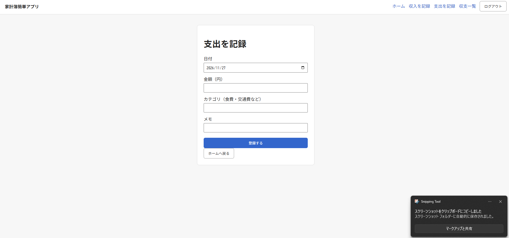
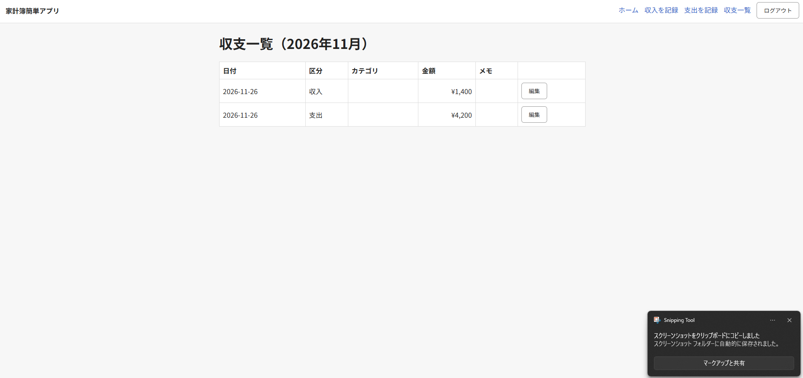
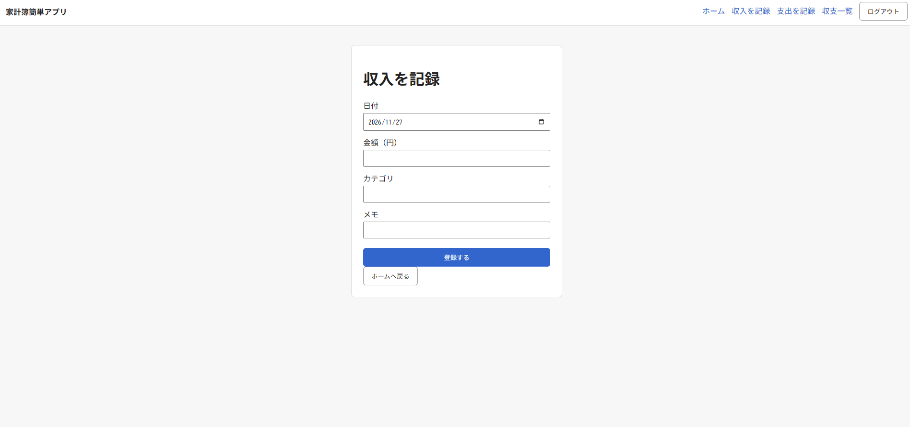
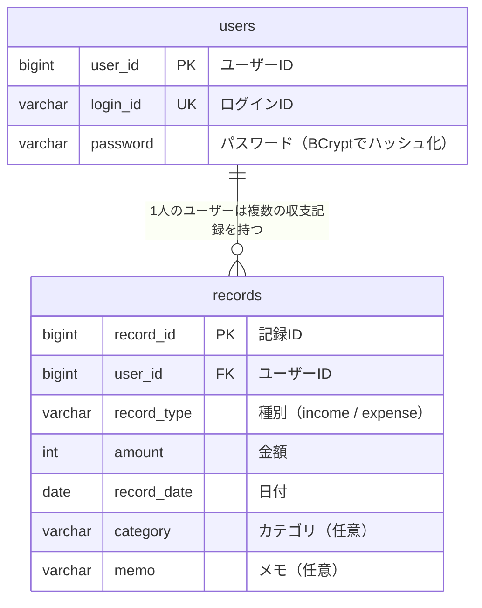

# 家計簿簡単アプリ

わかりやすく支出を管理できる、シンプルで使いやすい家計簿アプリです。

## アプリケーションの概要

個人向けの家計簿アプリです。収入と支出を記録すると、月ごとの収入合計・支出合計・残高が自動で集計され、今月のお金の流れを一目で確認できます。

## 開発した背景や理由

家計簿アプリは多機能なものが多く、入力が面倒で続かないことが課題だと考えました。本アプリは「記録する」「月ごとの合計を見る」という基本機能に絞り、誰でも迷わずできるだけシンプルに使えることを目標に開発しました。

工夫した点・苦労した点：
ログインのIDとパスワードの設定がうまくいかず何度もAIに聞いたり調べることで解決しました
できるだけシンプルに誰でも一目で操作方法がわかるように工夫しました
初めて自身で制作したので何度もエラーの原因を調べたり解決方法をAIに聞きながら制作しました

## スクリーンショット








## 主な機能

- ログイン認証
- ホーム画面：今月の収入合計・支出合計・残高の表示（年月を指定して切り替え可能）
- 収入の記録（日付・金額・カテゴリ・メモ）
- 支出の記録（日付・金額・カテゴリ・メモ）
- 収支一覧：今月の記録を一覧表示し、ダイアログから編集、ボタンから削除が可能

## 主な使用技術

- フロントエンド：React 18 / Vite / JavaScript（react-router-dom）
- バックエンド：Spring Boot 3（Java 17）
- データベース：SQLite
- 開発環境：VS Code / Git・GitHub

## ER図



## ローカル環境での起動方法

必要なもの：Java 17、Node.js

### バックエンド

1. DB Browser for SQLite で、プロジェクト直下に `kakeibo.db` を作成し、`db/schema_sqlite.sql` を実行する（「変更を書き込み」を押して保存し、DB Browserを閉じる）
2. VS Code でプロジェクトを開き、F5キーでバックエンドを起動する（http://localhost:8080）

### フロントエンド

```
cd frontend
npm install
npm run dev
```

http://localhost:5173 をブラウザで開く

### テストアカウント

- ログインID：test
- パスワード：test1234
